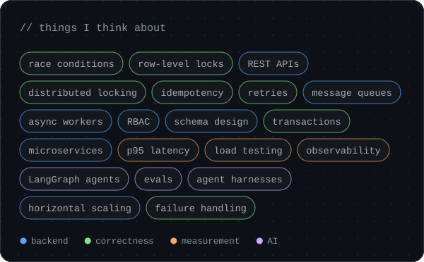
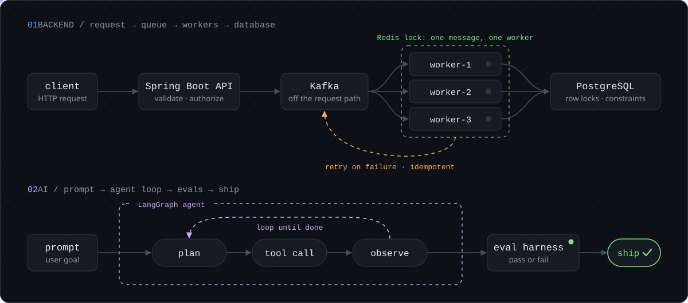
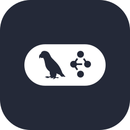
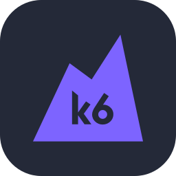
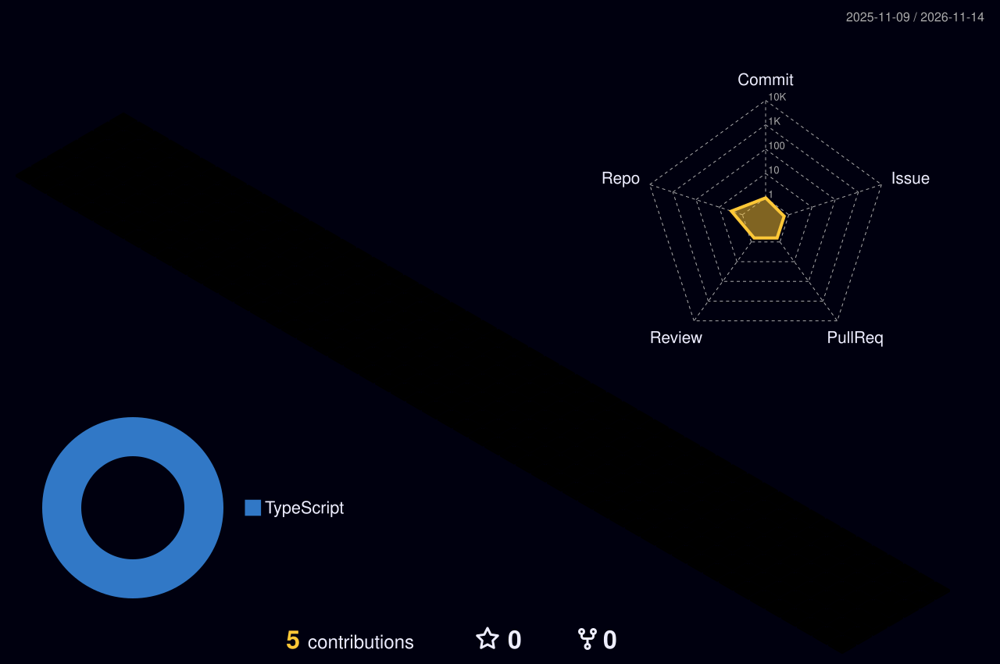

  

 

### Hi, I'm Likhith 👋

I'm an Associate Software Developer at **Webknot Technologies** in Bengaluru, a full stack developer with a backend focus. I own Java and Spring Boot services end to end, from requirements and data model through load testing and rollout. I like the hard parts of backend systems: race conditions, distributed locking, queue-based asynchronous processing and failure handling. I also build LLM applications and agents with LangChain and LangGraph.

  
  
  
  

  
  

## How my systems run

## Tech stack

| Area | Tools |
| :--- | :---- |
| **Languages** |  |
| **Backend** |  |
| **AI** |   |
| **Databases** |  |
| **Cloud and DevOps** |  |
| **Observability and testing** |    |

## Highlights

## LeetCode

  
  

## GitHub activity

  
  
  
  
  
  
  
  <picture>
    <source media="(prefers-color-scheme: dark)" srcset="https://raw.githubusercontent.com/likhithrajudev/likhithrajudev/output/snake-dark.svg" />
    
  </picture>

## Experience

## Bookshelf

| Book | Author | What it covers |
| :--- | :----- | :------------- |
| 📘 [Designing Data-Intensive Applications](https://dataintensive.net/) | Martin Kleppmann | Storage engines, replication, partitioning, transactions and stream processing: how data systems actually behave. |
| 📗 [System Design Interview: An Insider's Guide](https://www.amazon.com/dp/B08CMF2CQF) | Alex Xu | Worked designs for rate limiters, key-value stores, news feeds, chat systems and more. |

## How I work

- **Prove it, don't assume it.** If code has to be correct under concurrency, I fire concurrent requests at it and check, and I treat an LLM feature the same way: it isn't done until an eval says so.
- **Tail latency over averages.** I measure p95 under load before a rollout, not after a complaint.
- **Design for failure.** Retries and idempotent processing, so a redelivered or duplicated message never does damage, with a database constraint as the last line of defence.
